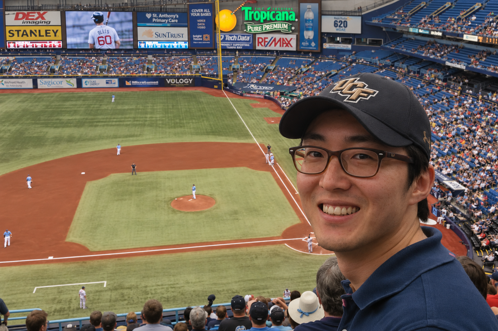

::: {.about-photo}
{width=75% fig-align="center" fig-alt="Kyungkook Kang wearing a UCF cap at Tropicana Field"}
:::

I am Associate Professor of Finance, Economics, and Business Analytics at the Tom & Vi Zapara School of Business, La Sierra University. I also serve as Associate Director of the Kido Center for Worldview Studies and as a Senior Fellow at the TransResearch Consortium.

As a political economist, I use economic theory, decision theory, and quantitative methods to study political interactions. My work examines how power, institutions, and values interact to shape strategic behavior, with interests in global politics, the geoeconomics of great powers, and the political economy of fiscal institutions. 

My current research develops formal models of power transition theory and uses simulations to examine their implications for U.S. defense policy. I also contribute to collaborative research in the scientific study of religion and health economics.

My research has appeared in *International Studies Quarterly*, *Conflict Management and Peace Science*, *International Interactions*, and *International Area Studies Review*, as well as in edited volumes published by international academic presses. I co-authored the book *Averting Nuclear War* (Springer, 2023) with Jacek Kugler.

I received my PhD through the interfield program in Political Science and Economics at Claremont Graduate University. My dissertation was titled *Conditional Deterrence: Microeconomic Analysis of War Initiation Mechanism*. Before joining La Sierra University, I taught at the University of Central Florida, Claremont Graduate University, and the University of Southern California.

I teach financial economics, managerial decision-making, and quantitative methods. My courses connect economic reasoning with the analysis of strategic decisions, emphasizing how to frame problems, evaluate evidence, and use analytical tools to make informed judgments under uncertainty. My teaching experience also spans undergraduate and graduate courses in international relations, political economy, quantitative methods, and formal modeling. I have supervised independent studies and served on thesis and dissertation committees.

Originally from Busan, South Korea, I live in Riverside, Southern California. My friends and students often call me “Dr. K3” (pronounced “kay-three”), and I like it.