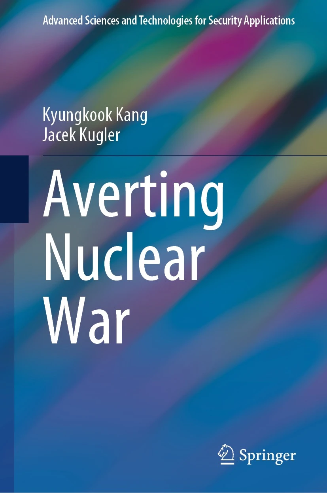

## Book

**Kang, Kyungkook**, and Jacek Kugler. 2023. *Averting Nuclear War*. Springer.

::: {.text-center}
[{width=220px fig-alt="Averting Nuclear War book cover"}](https://doi.org/10.1007/978-3-031-38688-6)

[View on Springer](https://doi.org/10.1007/978-3-031-38688-6)
:::

## Articles and Chapters

**Kang, Kyungkook**, and Yuzhu Zeng. 2027 (forthcoming). “Power Transition under Conditional Anarchy.” In *Generalized Power Transition Theory: A New Approach to International Interactions*, edited by Birol Yeşilada, Jacek Kugler, and Ron Tammen. Edward Elgar Publishing.
[Publisher](https://www.e-elgar.com/shop/gbp/generalized-power-transition-theory-9781049418285.html)

**Kang, Kyungkook**, Yuzhu Zeng, and Ali Fisunoğlu. 2027 (forthcoming). “Measuring Relative Power.” In *Generalized Power Transition Theory: A New Approach to International Interactions*, edited by Birol Yeşilada, Jacek Kugler, and Ron Tammen. Edward Elgar Publishing.
[Publisher](https://www.e-elgar.com/shop/gbp/generalized-power-transition-theory-9781049418285.html)

Zagare, Frank C., and **Kyungkook Kang**. 2027 (forthcoming). “Micro and Macro Foundations of Power Transition Theory: Perfect Deterrence Theory and Conditional Deterrence Theory.” In *Generalized Power Transition Theory: A New Approach to International Interactions*, edited by Birol Yeşilada, Jacek Kugler, and Ron Tammen. Edward Elgar Publishing.
[Publisher](https://www.e-elgar.com/shop/gbp/generalized-power-transition-theory-9781049418285.html)

Oyoyo, Udochukwu, **Kyungkook Kang**, and Walter Johnson. 2026. “Asking the Right Public Health Research Questions.” In *Translational Neurosurgery: Handbook for Designing and Conducting Clinical and Translational Research*, edited by Adam Eltorai, Jeffrey Bakal, and Maleeha Ahmad, 291–294. Elsevier.
[DOI](https://doi.org/10.1016/B978-0-323-90509-1.00030-8)

**Kang, Kyungkook**, and Jacek Kugler. 2023. “Beyond Deterrence: Uncertain Stability in the Nuclear Era.” *Conflict Management and Peace Science* 40 (6): 655–674.
[DOI](https://doi.org/10.1177/07388942221149670)

Fisunoğlu, Ali, **Kyungkook Kang**, Tadeusz Kugler, and Marina Arbetman. 2023. “Relative Political Capacity: A Dataset to Evaluate the Performance of Nations, 1960–2018.” *Conflict Management and Peace Science* 40 (3): 325–345.
[DOI](https://doi.org/10.1177/07388942221145352)

**Kang, Kyungkook**. 2020. “Northeast Asia: Challenge of Nuclear Deterrence.” In *The Rise of Regions: Conflict and Cooperation*, edited by Ronald L. Tammen and Jacek Kugler. Rowman & Littlefield.
[Publisher](https://www.bloomsbury.com/us/rise-of-regions-9781538131879/)

**Kang, Kyungkook**. 2020. Review of *When Right Makes Might: Rising Powers and World Order*, by Stacie E. Goddard. *Perspectives on Politics* 18 (1): 341–342.
[DOI](https://doi.org/10.1017/S1537592719004316)

**Kang, Kyungkook**. 2020. Review of *Super Continent: The Logic of Eurasian Integration*, by Kent E. Calder. *Political Science Quarterly* 135 (2): 335–336.
[DOI](https://doi.org/10.1002/polq.13045)

Yang, Zining, **Kyungkook Kang**, and Jacek Kugler. 2018. “An Agent-Based Approach on Conditional Deterrence.” In *Advances in Human Factors in Simulation and Modeling*, edited by Daniel Cassenti, 333–342. *Advances in Intelligent Systems and Computing*, vol. 591. Springer.
[DOI](https://doi.org/10.1007/978-3-319-60591-3_30)

**Kang, Kyungkook**, and Tadeusz Kugler. 2017. “International Political Economy and Political Demography: An Interdisciplinary Exploration.” In *Advancing Interdisciplinary Approaches to International Relations*, edited by Steve A. Yetiv and Patrick James, 263–287. Palgrave Macmillan.
[DOI](https://doi.org/10.1007/978-3-319-40823-1_9)

**Kang, Kyungkook**, and Jacek Kugler. 2015. “Assessment of Deterrence and Missile Defense in East Asia: A Power Transition Perspective.” *International Area Studies Review* 18 (3): 280–296.
[DOI](https://doi.org/10.1177/2233865915595762)

Kugler, Tadeusz, **Kyungkook Kang**, Jacek Kugler, Marina Arbetman, and John Thomas. 2013. “Demographic and Economic Consequences of Conflict.” *International Studies Quarterly* 57 (1): 1–12.
[DOI](https://doi.org/10.1111/isqu.12002)

**Kang, Kyungkook**, and Jacek Kugler. 2013. “Nuclear Weapons: Stability of Terror.” In *Debating a Post-American World: What Lies Ahead?*, edited by Sean Clark and Sabrina Hoque. Routledge.
[Publisher](https://www.routledge.com/Debating-a-Post-American-World-What-Lies-Ahead/Clark-Hoque/p/book/9780415690553)

Abdollahian, Mark, **Kyungkook Kang**, and John Thomas. 2012. “Setting the Stage: The Politics of Economic Growth.” In *The Performance of Nations*, edited by Ronald Tammen and Jacek Kugler. Rowman & Littlefield.
[Publisher](https://www.bloomsbury.com/us/performance-of-nations-9798216317142/)

Abdollahian, Mark, Marina Arbetman-Rabinowitz, **Kyungkook Kang**, Jacek Kugler, Hal Nelson, and Ronald Tammen. 2012. “Political Performance.” In *The Performance of Nations*, edited by Ronald Tammen and Jacek Kugler. Rowman & Littlefield.
[Publisher](https://www.bloomsbury.com/us/performance-of-nations-9798216317142/)

Abdollahian, Mark, and **Kyungkook Kang**. 2008. “In Search of Structure: The Nonlinear Dynamics of Power Transitions.” *International Interactions* 34 (4): 333–357.
[DOI](https://doi.org/10.1080/03050620802574887)

## Data

Fisunoğlu, Ali, **Kyungkook Kang**, Marina Arbetman-Rabinowitz, and Jacek Kugler. *Relative Political Capacity Dataset*, version 2.4. Harvard Dataverse.
[Access the dataset](https://doi.org/10.7910/DVN/NRR7MB).

## Selected Conference Presentations

- 2027 (scheduled): “Conditional Anarchy: Satisfaction, Power, and
  Hierarchy in International Interactions.” International Studies
  Association, Atlanta, GA.
- 2026: “Religion as Formation: Worldview Development Across Values,
  Cognition, and Decision-Making,” with Elissa Kido and Udochukwu Oyoyo.
  Society for the Scientific Study of Religion, Denver, CO.
- 2026: “Toward a Decision-Structural View of Religion: Evidence from
  Domain-Specific Cognition and Worldview Axes in Belief Formation,”
  with Udochukwu Oyoyo and Elissa Kido. Society for the Scientific Study
  of Religion, Denver, CO.
- 2026: “Measuring Great Power Transitions: 1980–2030,” with Yuzhu Zeng and Ali Fisunoğlu. International Studies Association–West, Pasadena, CA.
- 2026: “Measuring Great Power Transitions: 1980–2029,” with Yuzhu Zeng and Ali Fisunoğlu. International Studies Association, Columbus, OH.
- 2026: “Generalized Power Transition Theory: Conflict and Cooperation
  Assessment,” with Yuzhu Zeng and Jacek Kugler. International Studies
  Association, Columbus, OH.
- 2025: “Multidimensional Worldviews: Conceptual and Measurement Issues,”
  with Elissa Kido and Udochukwu Oyoyo. Society for the Scientific Study of
  Religion, Minneapolis, MN.
- 2025: “General Theory of Conflict and Cooperation in World Politics,”
  with Jacek Kugler and Yuzhu Zeng. International Studies Association, Chicago, IL.
- 2025: “Make Your Choices Better Than Chance: Confirmatory Factor
  Analysis of the Worldview Index,” with Man Ka Wong, Kendal Boyd,
  Daniel Kido, Udochukwu Oyoyo, and Elissa Kido. American Psychological
  Association, Denver, CO.
- 2025: “Make Your Choices Better Than Chance: Exploratory Factor
  Analysis of the Worldview Index,” with Man Ka Wong, Kendal Boyd,
  Elissa Kido, Udochukwu Oyoyo, and Daniel Kido. Western Psychological
  Association, Las Vegas, NV.
- 2024: “Conditional Anarchy: Conflict and Cooperation in World Politics,”
  with Jacek Kugler and Yuzhu Zeng. International Studies Association,
  San Francisco, CA.

## Selected Invited Presentations

- 2026: “Rational Decision-Making in the Spiritual Life.”
  1st Symposium – Biblical-Christian Worldview, Adventist University
  Center of São Paulo (UNASP), Engenheiro Coelho, Brazil, August 20.
- 2026: “Behavior Game Theory and Worldview.”
  1st Symposium – Biblical-Christian Worldview, Adventist University
  Center of São Paulo (UNASP), Engenheiro Coelho, Brazil, August 20.
- 2025: “The Asymmetric Bet: Making Sacred Decisions in a Secular World.”
  Seventh-day Adventist Church, Office of Adventist Mission–Global Mission
  Centers Directors’ Meeting, Prague, Czechia, December 2.
- 2025: “Worldview and Adventist Education.”
  Seventh-day Adventist Church, Office of Adventist Mission–Global Mission
  Centers Directors’ Meeting, Prague, Czechia, December 2.
- 2025: “Arithmetic of World Politics: Evaluating Great Power Transitions,
  1980–2029.” Claremont Graduate University, April 1.
- 2023: “Averting Nuclear War.” Claremont Graduate University, October 24.
- 2018: “Power Transition Deterrence and Future Nuclear Competition.”
  National Assembly Futures Institute of the Republic of Korea, Seoul,
  December 21.
- 2017: “An Agent-Based Model of Escalation Dynamics in an Era of WMD
  Proliferation.” Claremont Graduate University, October 17.
- 2017: “Conditional Deterrence,” with Jacek Kugler. Norwegian Nobel
  Institute, Oslo, May 23.
- 2015: “Theoretical Assessment of Deterrence Stability.” Peace Research
  Institute Oslo, April 30.

## Media Coverage

- 2011: [“Rethinking the Unthinkable.”](https://www.technologyreview.com/2011/10/25/190270/rethinking-the-unthinkable/) *MIT Technology Review*, October 25.

## Methods and Tools

Methods: Formal models of strategic interaction; econometrics; causal
inference and machine learning; computational social science.

Software: Stata, R, Python, Mathematica, MATLAB, SigmaPlot, AnyLogic,
NetLogo, Pajek, UCINET, and Vensim.